<div align="center">




<br/>

<a href="YOUR_LINKEDIN_LINK_HERE">
  
</a>
<a href="mailto:manikantamani12345006@gmail.com">
  
</a>
<a href="https://github.com/Manikantamani006">
  
</a>

</div>

<br/>

```javascript
const developer = {
  name: 'Manikanta R.B.',
  username: 'Manikantamani006',
  education: 'Bangalore Institute of Technology',
  role: 'Prompt Engineer & Developer @ ZedRoutz',
  bio: 'Building real-world ML & deep learning solutions 🚀',
  focus: ['NLP', 'Deep Learning', 'Time-series', 'Applied ML'],
  sayHi: function () {
    console.log("Learning by building! Reach out at manikantamani12345006@gmail.com");
  }
};
```

---

## 🧠 About Me

- 🔭 Working as a **Prompt Engineer & Developer @ ZedRoutz**
- 🌱 Studying at **Bangalore Institute of Technology**, building **real-world ML projects** along the way
- 💡 I like practical innovation, creative problem-solving, and turning AI concepts into things that run
- 📫 Reach me at **[manikantamani12345006@gmail.com](mailto:manikantamani12345006@gmail.com)**

<br/>

## 🚀 Featured Projects

<table>
  <tr>
    <td width="33%" valign="top">
      <h3>💬 Emotion Prediction using NLP</h3>
      <p>Predicts the emotion behind a piece of text using a Natural Language Processing pipeline.</p>
      <p><code>NLP</code> <code>Machine Learning</code> <code>Python</code></p>
      <p><a href="https://github.com/Manikantamani006/Emotion-Prediction-using-NLP-"><b>View repository →</b></a></p>
    </td>
    <td width="33%" valign="top">
      <h3>🫀 Heart Disease Prediction</h3>
      <p>End-to-end ML model that predicts cardiovascular risk from clinical data.</p>
      <p><code>Scikit-learn</code> <code>Pandas</code> <code>Classification</code></p>
      <p><a href="https://github.com/Manikantamani006/Heart-Diease-Prediction"><b>View repository →</b></a></p>
    </td>
    <td width="33%" valign="top">
      <h3>🪐 Exoplanet Discovery (TESS)</h3>
      <p>Automated exoplanet discovery in NASA TESS data using Box Least Squares (BLS) and 1D Convolutional Neural Networks (1D-CNNs).</p>
      <p><code>Deep Learning</code> <code>1D-CNN</code> <code>BLS</code></p>
      <p><a href="https://github.com/Manikantamani006/bhar-isro"><b>View repository →</b></a></p>
    </td>
  </tr>
</table>

<sub>Also: 📊 <a href="https://github.com/Manikantamani006/Titanic_survivor">Titanic Survivor</a> · EDA and predictive modeling on real-world datasets</sub>

<br/>

## 💻 Skills & Tools

**Languages**<br/>


**Machine Learning**<br/>


**Deep Learning**<br/>


**Natural Language Processing**<br/>


<br/>

## 📈 GitHub Stats

<p align="center">
  
  
</p>

### 🎮 Pacman Contribution Graph

<p align="center">
  
</p>

<p align="center">✨ <em>Learning by building</em> 🚀</p>
