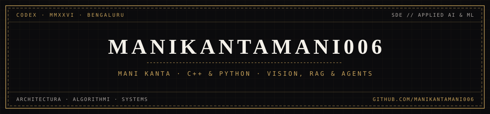



<strong>MANI KANTA (MANIXULTRA006)</strong> · SDE &amp; APPLIED AI/ML · BENGALURU, INDIA

---

### I. COMMENTARII (ABOUT & FOCUS)

| FIELD | SPECIFICATION |
| :--- | :--- |
| **IDENTITY** | Mani Kanta (`ManiXUltra006`) — B.E. AI/ML &amp; CSE, BIT Bengaluru (VTU) |
| **PRIMARY DOMAIN** | Software Development Engineering (SDE) — C++ &amp; Python systems |
| **SPECIALIZATION** | Applied Machine Learning, Computer Vision, RAG &amp; Agentic Pipelines |
| **DISCIPLINA** | Daily Data Structures &amp; Algorithms (DSA) in C++ and core CS fundamentals |
| **LOCUS** | Bengaluru, Karnataka, India |

---

### II. OPERA SELECTA (SELECTED SYSTEMS)

| SYSTEM | ARCHITECTURE &amp; STACK | FOCUS |
| :--- | :--- | :--- |
| **DocuTamper AI** | Dual-stream CNNs (`ResNet-34`), Error Level Analysis (ELA), metadata forensics | Digital document forgery detection &amp; tampering localization |
| **Sentiment Engine (`sentimental-analysis--2`)** | Fine-tuned `DistilBERT` + custom web UI (`HTML/CSS/JS`) | Real-time text sentiment inference &amp; web serving |
| **RAG Component Retrieval** | Web ingestion, dense embeddings, vector similarity search, structured JSON output | Grounded context &amp; matched-component retrieval pipelines |
| **Churn Prediction Suite** | Hyperparameter-tuned `LogisticRegression`, `RandomForest`, `LightGBM`, `XGBoost` | Tabular classification benchmarking &amp; feature evaluation |
| **Desktop AI Assistant** | Local OS automation with LLM API fallback | Desktop workflow orchestration &amp; command execution |

---

### III. ARSENAL TECHNICUM (STACK)

* **LINGUAE:** `C++` · `Python` · `HTML5` · `CSS3` · `JavaScript`
* **INTELLIGENTIA &amp; DATA:** `PyTorch` · `TensorFlow` · `Scikit-Learn` · `Transformers` · `RAG &amp; Agents` · `OpenCV` · `Polars` · `Pandas` · `LMDB`
* **OFFICINA:** `Git` · `GitHub` · `VS Code` · `Jupyter Notebook` · `PowerShell`

---

### IV. TELEMETRIA &amp; CONTRIBUTION SNAKE

 

